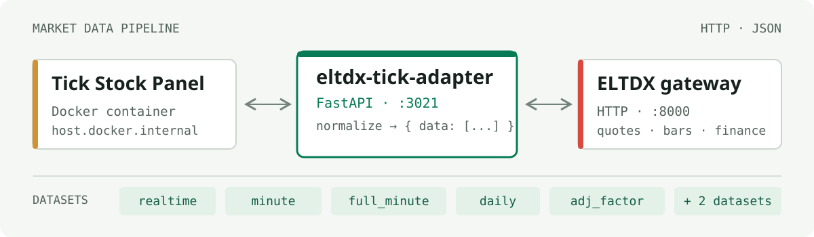

# market-data-tick-adapter

将 [ELTDX](https://electkismet.github.io/eltdx/) 行情转换为 [Tick Stock Panel](https://github.com/shy3130/tick-stock-panel) 的 HTTP 数据源；ELTDX 不可用时用 [AkShare](https://github.com/akfamily/akshare) 回退。项目仍是 Python FastAPI 服务，不需要 Node.js 或 API Key。

## 部署

要求 Python 3.11+、运行中的 ELTDX HTTP Gateway。默认网关地址在 [`config/data_sources.toml`](./config/data_sources.toml) 中配置，当前为 `http://127.0.0.1:8001`，以实际服务器为准。

<p align="center">
  
</p>

```bash
cd /opt/market-data-tick-adapter
python3.11 -m venv .venv
.venv/bin/python -m pip install -e '.[test]'
.venv/bin/python -m pytest -q
```

现有 `market-data-tick-adapter.service` 使用原监听地址/端口（默认 `127.0.0.1:3021`）；若面板容器通过宿主网桥访问，请保留已验证的 HOST 配置。切换分支部署前备份配置和服务单元，避免覆盖服务器本地设置。

## 数据流

所有业务端点保持 `{"data": [...]}`，`GET /health` 返回服务状态：

| 数据 | 接口 | 来源 |
| --- | --- | --- |
| 全市场实时快照 | `GET /realtime` | ELTDX → AkShare |
| 日 K | `POST /daily` | ELTDX → AkShare |
| 分钟 K | `POST /minute`、`POST /full_minute` | ELTDX → AkShare |
| 复权因子 | `POST /adj_factor` | ELTDX → AkShare |
| 财务报告 | `POST /financial` | ELTDX → AkShare |
| 五档盘口 | `POST /depth5` | ELTDX → AkShare |

AkShare 回退保留原始请求参数、时间过滤、复权因子格式和百分数转小数约定。`config/data_sources.toml` 可单独关闭 AkShare 或设置等待超时。AkShare 的全市场腾讯快照一次抓取可能耗时约 10 秒，仅在 ELTDX 请求失败时触发，并缓存 15 秒；AkShare 的分钟数据可用历史窗口由其上游决定，不能替代 ELTDX 的任意时间范围全量分钟数据。数据源返回缺失字段时保持空值，不猜造行情。AkShare 接口依赖第三方网站，限流或上游变更时返回 502。

面板配置 [`tick-stock-panel.yaml`](./tick-stock-panel.yaml) 的 URL、字段映射与响应路径无需改动。
